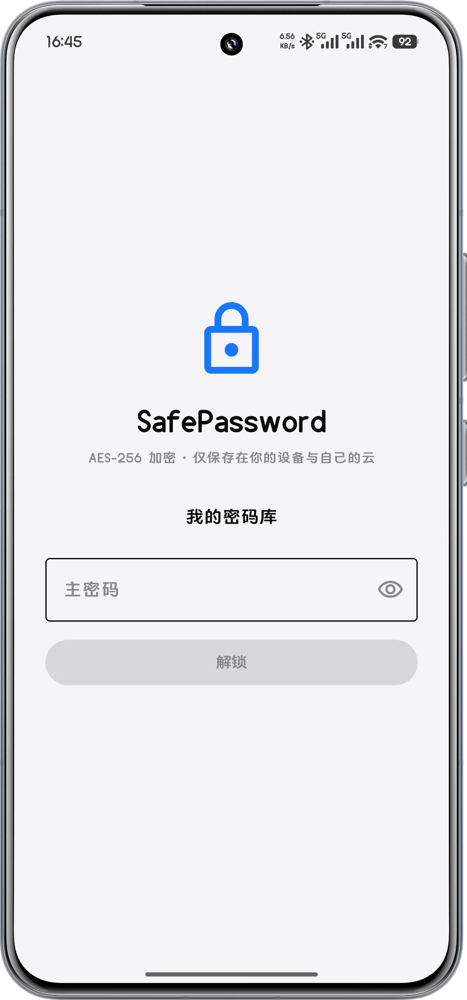
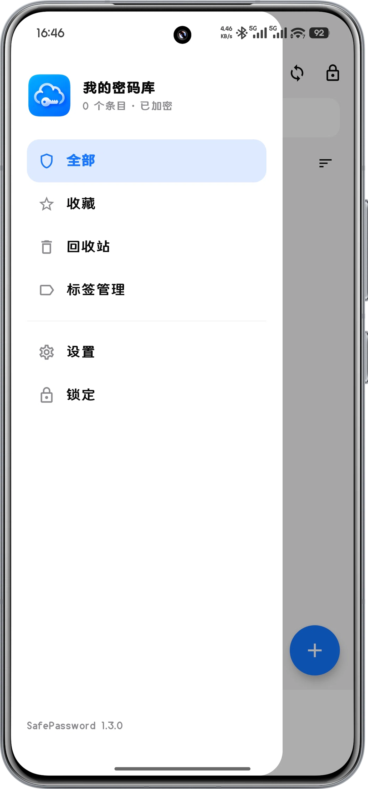
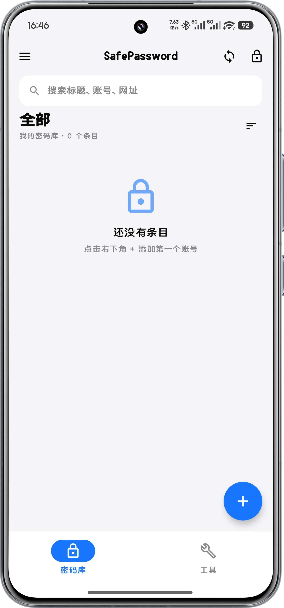
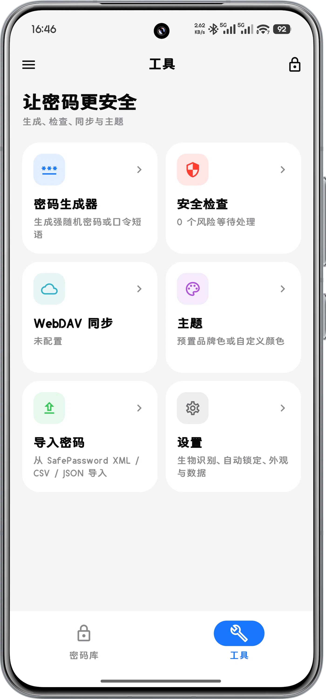
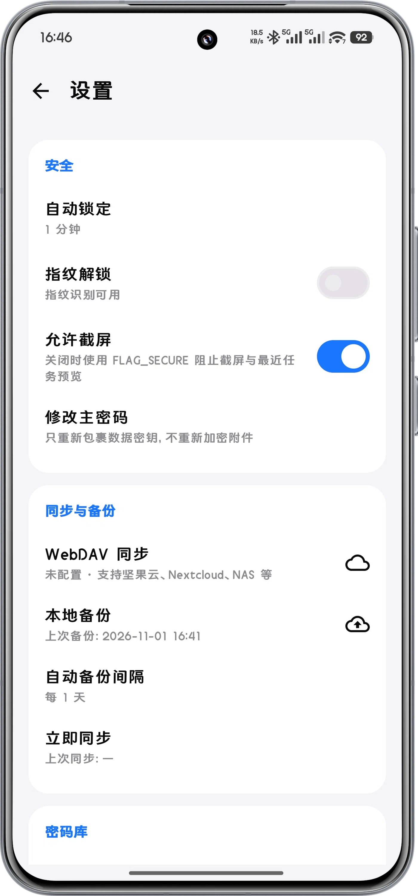
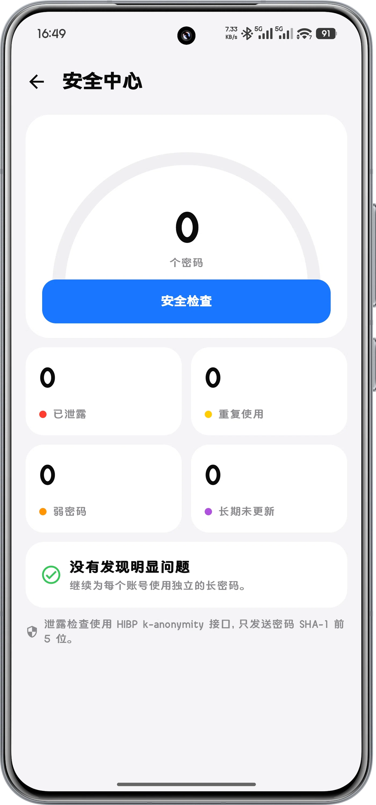

# SafePassword

SafePassword 是一个离线优先的密码管理器。当前提供 Android 客户端，使用 Kotlin + Jetpack Compose 实现；共享核心为纯 Kotlin/JVM。数据默认只保存在本机，通过主密码派生密钥后加密存储；需要多设备同步时，可选用任意兼容 WebDAV 的网盘。

- 项目名：`SafePassword`
- 包名：`com.yaoahos.safepassword`
- 正式版本：`1.1.1`（versionCode 16）
- 最低系统：Android 8.0（API 26）
- 目标系统：Android 15（API 35）
- 正式 APK：`SafePassword-1.1.1-release.apk`
- APK 大小：3,060,105 字节
- SHA-256：`c3beb25f56b0fe532c3fbb56cb5cfc248750e9781ea76cef936d296ae6063877`
- 发布下载：[Releases](https://github.com/yaoahos/SafePassword/releases)

> 本项目为独立实现，未使用任何第三方应用的源代码；界面与交互仅作设计参考。

---

## 界面预览

| 解锁 | 侧边导航 | 密码库 |
| :---: | :---: | :---: |
|  |  |  |

| 工具 | 设置 | 安全中心 |
| :---: | :---: | :---: |
|  |  |  |

---

## 一、软件介绍

SafePassword 面向希望把密码数据掌握在自己手里的用户。它不依赖厂商云，不要求注册账号，也不包含密码填充、共享协作或广告分析。密码库文件在离开设备前已经完成加密，WebDAV 只负责传输密文。

设计目标：

1. **本地优先**：没有网络也能完整使用。
2. **可迁移**：密码库、备份和导出文件可以自由复制。
3. **可审计**：核心加密与同步逻辑位于独立的纯 Kotlin 模块，便于测试和复用。
4. **克制**：不申请无关权限，不接入统计 SDK，不做后台常驻。
5. **跨尺寸可用**：手机、平板和横屏共用一套 Compose UI。

---

## 二、功能一览

**密码库**
- 创建多个密码库，每个使用独立主密码；主密码解锁、指纹解锁、自动锁定。
- 重命名、切换、删除；本地加密备份与恢复。
- 新设备或重装后可从本地文件或 WebDAV 恢复。

**条目**
- 新建、编辑、查看、复制、删除；回收站支持软删除、恢复与永久删除。
- 字段类型：文本、密码、秘密、网址、邮箱、电话、文件（单个 ≤50KB 小文件）、TOTP 动态验证码；支持增删、改名与上下移动。
- 密码独立显示/隐藏，附强度提示；可收藏、打多标签、批量选择。
- 支持自定义图片图标：按 192×192 归一化（4:3 内居中裁切、超出等比留白），编码时 PNG / WebP 择优（图形类 PNG 约 1KB，照片类 WebP 约 15KB），按需解码。

**搜索与排序**
- 常驻搜索框，可搜标题、账号、网址，可选是否搜索密码内容。
- 排序支持标题、最近修改、最近创建，默认按创建时间降序；重复点击同一种排序会反转方向，中文按拼音排列。

**同步与安全**
- 任意标准 WebDAV 同步，测试连接、拉取云端、保存并同步；删除以墓碑方式同步，避免其他设备把已删条目传回云端。
- 可选自动拉取云端更新（关闭 / 30 秒 / 1 分钟 / 5 分钟），只发 HEAD 判断是否有改动。
- 密码生成器（随机密码与口令短语）、安全检查（强度、重复、长期未修改、HIBP k-匿名泄露查询）。

**导入导出与外观**
- 导入 CSV、JSON 与兼容格式 XML，支持多选；导出 CSV、JSON、XML。
- 预置主题色与自定义颜色；平板/横屏使用限宽内容区和多列网格；可配置是否允许截屏。

---

## 三、技术选型

| 层次 | 选型 | 说明 |
| --- | --- | --- |
| 语言 | Kotlin 2.1.0 | Android 与共享核心均使用 Kotlin |
| UI | Jetpack Compose + Material 3 | 声明式 UI，支持手机/平板 |
| 构建 | Gradle 8.11.1 + AGP 8.7.3 | JDK 17 字节码 |
| 共享核心 | 纯 Kotlin/JVM `:core` | 加密、模型、导入导出、WebDAV、同步 |
| 网络 | Ktor Client 3.0.3 + OkHttp | WebDAV 与 HIBP 请求 |
| 序列化 | kotlinx.serialization 1.7.3 | JSON 密码库与配置 |
| 协程 | kotlinx.coroutines 1.9.0 | IO 与 UI 状态切换 |
| 设置存储 | AndroidX Security Crypto | `EncryptedSharedPreferences` 保存敏感配置 |
| 生物识别 | AndroidX Biometric 1.1.0 | 指纹解锁，调用系统能力 |
| 图标 | Material Icons Extended | 界面图标 |
| 最低版本 | API 26 | Android 8.0 |
| 目标版本 | API 35 | Android 15 |

核心模块不依赖 Android，只承载与平台无关的加密、模型与同步逻辑，便于单元测试与复用。Android 层负责 Compose UI、文件选择器、生物识别和系统设置跳转。

---

## 四、安全设计

### 1. 密码库加密

- 主密码通过 **PBKDF2-HMAC-SHA256** 派生密钥，迭代次数 **210,000**。
- 使用 **AES-256-GCM** 加密密码库内容。
- 每次加密生成随机 12 字节 IV，GCM 认证标签 128 位。
- 密码库内容使用数据密钥（DEK）加密，DEK 再由主密码派生的密钥包裹，便于后续更换主密码而无需重加密全部数据。
- 主密码不写入磁盘，也不上传到任何服务器。
- 密码库文件、备份文件在离开设备前均为密文。

### 2. 本地配置

- WebDAV 地址、用户名、密码等敏感配置保存在 `EncryptedSharedPreferences` 中。
- 加密密钥由 Android Keystore 的 AES-256-GCM 主密钥保护。
- 普通偏好设置（主题、排序、默认标签等）与敏感配置分离。
- 如果系统加密存储初始化失败，应用不会静默改存明文。

### 3. 生物识别与自动锁定

- 使用 AndroidX BiometricPrompt 调用系统指纹能力，不接触指纹原始数据。
- 指纹开关的开启和关闭都需要系统生物识别确认。
- **指纹解锁不是界面门禁**：主密码用 Android Keystore 中一把「每次使用都要用户认证」的 AES-256 密钥加密后存储，解密必须通过 BiometricPrompt 的 CryptoObject 授权；没有指纹就无法还原主密码。
- 指纹被重新录入或全部删除时，系统会作废该密钥，应用自动清除失效凭据并要求重新开启。
- 指纹传感器硬件损坏等无法使用的情况出现时，应用自动关闭指纹解锁，不再要求先验证指纹才能关闭。
- 修改主密码后指纹凭据自动失效，需要重新开启（避免旧密码残留在磁盘上）。
- 支持自动锁定；应用退到后台、或停留在前台闲置超过设定时间后回到解锁界面，需重新解锁（主密码或指纹）。手动锁定与超时锁定都停留在应用内的解锁界面，不会把应用退回桌面。
- 两段计时：退到后台记录时刻（`onStop` → `onAppBackgrounded`），前台闲置按最近一次触摸计时（`AppRoot` 上报 `onUserInteraction`，解锁后由 `restartIdleWatch` 每秒检查）。计时一律用 `SystemClock.elapsedRealtime()` 开机时钟，改系统时间或自动对时不会影响判定；设为「从不」时不启动前台计时。
- 锁定会清除内存中的主密码与解密后的数据，但不结束应用进程，也不重建界面。
- 生物识别失败时保留主密码解锁入口。

### 4. 网络与隐私

- 仅在用户主动配置 WebDAV 或启用 HIBP 查询时访问网络。
- 不包含统计、广告、崩溃上报 SDK。
- HIBP 使用 SHA-1 前缀查询，服务端无法从请求中直接得到完整密码。
- 密码库同步传输的是密文文件；WebDAV 服务商只能看到密文和文件大小。
- 明文流量策略集中在 `apps/android/src/main/res/xml/network_security_config.xml`：因为要支持用户自建的 HTTP WebDAV 服务才允许 cleartext，TLS 仍只信任系统 CA。
- WebDAV 的 Basic 认证凭据只在目标主机上附加，服务端发生跨域重定向时不会把密码带给第三方主机。
- 截屏默认禁止（FLAG_SECURE 阻止截屏与最近任务预览），需要时可在设置里手动允许。
- 复制的密码会标记为敏感剪贴板内容，Android 13 及以上不会在剪贴板预览中显示明文。
- 安装更新只接受应用自己下载到 `cache/updates/` 的 APK，其他应用无法通过外部 Intent 触发安装。
- 条目删除以墓碑方式同步：本机删除的条目不会被云端旧数据复活，墓碑默认保留 90 天。

### 5. 发布签名

- 正式 APK 使用单独的 release keystore 签名。
- `release.keystore` 与 `keystore.properties` 已加入 `.gitignore`，不应提交到版本库。
- 一旦丢失 release keystore，已安装用户将无法覆盖升级，请离线备份。

> 安全边界：主密码遗忘后无法恢复；请同时保留加密备份。任何密码管理器都不能防御已 root、被植入木马或被实时录屏的设备。

---

## 五、项目构建

### 1. 环境要求

- JDK 17 或更高。
- Android SDK Platform 35、Build-Tools 35.0.0（仅构建 Android 版需要）。
- Gradle 使用项目自带的 Wrapper（8.11.1），无需单独安装。
- Windows、macOS、Linux 均可构建 Android 版。

### 2. 配置 SDK 路径

在项目根目录创建 `local.properties`：

```properties
sdk.dir=C\:\\path\\to\\Android\\Sdk
```

也可以直接使用 Android Studio 打开项目，由 IDE 生成。

### 3. 调试构建

```bat
gradlew.bat :core:test :apps:android:assembleDebug
```

产物：

```text
apps/android/build/outputs/apk/debug/android-debug.apk
```

### 4. 正式构建

正式构建需要 release keystore。项目根目录应存在：

```text
release.keystore
keystore.properties
```

`keystore.properties` 示例：

```properties
storeFile=release.keystore
storePassword=你的_store_password
keyAlias=safepassword
keyPassword=你的_key_password
```

生成新的 keystore：

```bat
keytool -genkeypair -v -keystore release.keystore -alias safepassword -keyalg RSA -keysize 2048 -validity 10000
```

构建：

```bat
gradlew.bat :core:test :apps:android:assembleRelease
```

release 构建已启用代码压缩与资源收缩，并只保留真机 ABI：

- R8 代码压缩与混淆（`isMinifyEnabled = true`）
- 资源收缩（`isShrinkResources = true`）
- ABI 仅 `arm64-v8a`、`armeabi-v7a`（去掉模拟器专用的 x86 / x86_64）
- 压缩后 APK 体积约 2.5 MB

混淆映射保存在 `apps/android/build/outputs/mapping/release/mapping.txt`，排查线上崩溃时用它将堆栈还原为可读的类名与方法名。若需要保留独立调试包，debug 构建不做压缩和 ABI 过滤，行为与之前一致。

产物：

```text
apps/android/build/outputs/apk/release/android-release.apk
```

重命名并复制到 `dist/`：

```bat
copy apps\android\build\outputs\apk\release\android-release.apk dist\SafePassword-1.0.10-release.apk
```

### 5. 校验 APK

```bat
apksigner.bat verify --verbose dist\SafePassword-1.0.10-release.apk
aapt.exe dump badging dist\SafePassword-1.0.10-release.apk
```

当前正式包的校验结果：

- `package: com.yaoahos.safepassword`
- `versionCode: 7`
- `versionName: 1.0.10`
- `application-label: SafePassword`
- APK Signature Scheme v2：通过
- 权限：`INTERNET`、`USE_BIOMETRIC`、`USE_FINGERPRINT`、`POST_NOTIFICATIONS`、`REQUEST_INSTALL_PACKAGES`、`CAMERA`（仅扫码录入动态验证码时使用，可拒绝并从相册选图）

### 6. 测试

- `:core:test` 覆盖加密、密码库容器、WebDAV 客户端、XML 导入导出、TOTP（RFC 6238 向量）、工具函数等。
- 当前核心测试 70/70 通过（新增 7 条二维码解码、11 条图标归一化用例）。

---

## 六、使用说明

**首次启动**：只有在不存在任何密码库时，欢迎页才显示「创建密码库 / 从本地恢复 / 从云端恢复」；已有密码库时只显示解锁入口，避免误操作覆盖现有数据。

**恢复数据**

- 从本地恢复：欢迎页选 `.spv` 导出文件 → 输入该文件主密码 → 可改名 → 进入密码库。
- 从云端恢复：填 WebDAV 地址、用户名、密码、远程目录 → 「读取云端密码库」列出云端已有的库 → 选中一个 → 输入该库的主密码 → 下载并导入本地。失败会保留配置并提示原因。

**日常使用**

- 解锁：主密码，或在设置中开启指纹后按系统提示验证。指纹开关的开启与关闭都会再次验证指纹。
- 条目：点条目进详情，右下角按钮新建或编辑，长按进入多选可批量删除或设置标签，星标即时生效，删除后进回收站。
- 标签：侧边栏 → 标签管理，新建时可设名称、颜色和排序值（排序值越小越靠前），长按可批量删除。
- 搜索：顶部搜索框输入标题、账号或网址；设置中可开启「搜索密码」；搜索框聚焦后侧滑或返回会先清空搜索而不退出页面。
- 主题：工具 → 主题，预置色为圆形色块，也支持输入 `#RRGGBB` 自定义，可切换深色模式。
- 同步：工具 → WebDAV 同步，填写服务器地址、用户名、密码和远程目录后先「测试连接」再「保存并立即同步」；多设备用同一远程目录即可共享同一批密码库文件，每个密码库各自一个文件，由 `SafePassword-index.json` 记录清单。
- 备份：设置 → 本地备份，先选择保存目录（系统文件选择器，可放 SD 卡或网盘同步目录），再创建加密备份或设置自动备份间隔；恢复时需输入该备份的主密码。
- 导入导出：工具 → 导入密码支持多选 CSV、JSON 与 XML；设置 → 数据可导出 CSV、JSON、XML。
- TOTP 认证器：新建/编辑字段时选「动态验证码」类型，字段右侧 ⋮ 菜单里的「扫码录入密钥」可直接对着网站给出的二维码扫，也能从相册选一张二维码截图识别；也可以手动粘贴 `otpauth://` 链接或 Base32 密钥（密钥文件码）。详情页实时显示 6 位动态码与剩余秒数，复制按钮复制的是当前动态码，眼睛按钮可查看密钥原文。

**平板与横屏**：内容区限宽，密码库与工具页使用多列布局，顶栏、抽屉、详情和编辑页保持同一套结构，旋转屏幕后页面状态尽量保留。

---

## 七、项目结构

项目采用"平台应用 + 共享核心"的结构。`core` 是纯 Kotlin/JVM 共享核心，Android 应用层直接复用它的加密、模型、导入导出和 WebDAV 能力，UI 与平台粘合层在 `apps/android` 内实现。

```text
SafePassword/
├── apps/
│   └── android/                Android 应用层（Compose UI、Activity、文件选择器）
│       ├── src/main/kotlin/com/yaoahos/safepassword/android/
│       │   ├── ui/             页面、组件、主题、导航
│       │   ├── data/           设置、备份、同步调度
│       │   ├── security/       生物识别
│       │   └── MainActivity.kt
│       └── src/main/res/       图标、字符串、主题资源
├── core/                       纯 Kotlin/JVM 共享核心
│   └── src/main/kotlin/com/yaoahos/safepassword/core/
│       ├── crypto/             AES-GCM、PBKDF2、密钥包裹
│       ├── model/              密码库、条目、标签、字段、模板
│       ├── storage/            密码库容器、本地存储
│       ├── io/                 文件读写、导入导出、XML
│       ├── sync/               WebDAV、同步引擎、合并策略
│       ├── json/               序列化配置
│       └── security/           密码强度、生成器、HIBP
├── gradle/                     Gradle Wrapper
├── dist/                       正式 APK
├── release.keystore            正式签名（本地，不提交）
├── keystore.properties         签名配置（本地，不提交）
├── build.gradle.kts
├── settings.gradle.kts
└── README.md
```

Gradle 模块路径：

- `:core`：共享核心
- `:apps:android`：Android 客户端

包名说明：

- Android `applicationId`：`com.yaoahos.safepassword`
- Android 命名空间：`com.yaoahos.safepassword.android`
- 核心库包名：`com.yaoahos.safepassword.core`

---

## 八、兼容性与限制

- 仅支持 Android 8.0 及以上。
- 仅支持 WebDAV 同步，不接入专有云 API。
- 不包含密码填充/自动填充。
- 不包含共享协作、团队空间。
- 不提供浏览器密码自动填充或系统级凭据注入。
- 不支持条目级附件管理；字段级仅限单个 ≤50KB 小文件，且不支持应用内预览（可导出到本地查看）。
- 主密码遗忘后无法恢复；请务必保留备份。
- XML 导入以标准条目、字段、标签、备注和图标为主；原版附件文件不会导入。
- 云端冲突默认本地优先；如需以云端为准，请使用“拉取云端数据（覆盖本地）”。
- 密码库文件与备份均为加密的 gzip 压缩内容。

---

## 九、开源组件与致谢

本项目使用或依赖以下开源项目，感谢其作者与社区：

- [Kotlin](https://kotlinlang.org/) — Apache-2.0
- [Jetpack Compose](https://developer.android.com/jetpack/compose) — Apache-2.0
- [AndroidX](https://developer.android.com/jetpack/androidx) — Apache-2.0
- [Material Components for Android](https://github.com/material-components/material-components-android) — Apache-2.0
- [Ktor](https://ktor.io/) — Apache-2.0
- [OkHttp](https://square.github.io/okhttp/) — Apache-2.0
- [kotlinx.serialization](https://github.com/Kotlin/kotlinx.serialization) — Apache-2.0
- [kotlinx.coroutines](https://github.com/Kotlin/kotlinx.coroutines) — Apache-2.0
- [AndroidX Biometric](https://developer.android.com/jetpack/androidx/releases/biometric) — Apache-2.0
- [AndroidX Security Crypto](https://developer.android.com/jetpack/androidx/releases/security) — Apache-2.0
- [Have I Been Pwned](https://haveibeenpwned.com/) — 泄露查询 API

界面设计参考公开截图，代码、数据结构和实现均为独立完成。

---

## 十、版本记录

**2026/11/13 · 1.1.1**
- 变更 删除密码库只删除本机文件，云端副本保留，误删可随时从云端重新下载
- 新增 云端密码库列表显示已下载到本机的库，可就地删除云端那一份（不影响本机）

**2026/11/13 · 1.1.0**
- 新增 动态验证码字段：保存 otpauth:// 链接或 Base32 密钥，详情页实时生成 6 位动态码并一键复制；支持相机扫码录入，也能从相册选二维码截图识别
- 新增 文件字段：可保存单个 50KB 以内的小文件，随密码库加密与同步，支持导出到本地
- 新增 从屏幕左边缘右滑返回上一页，页面切换加入水平推入转场
- 新增 字段名留空时按类型自动命名；标签分类下新建条目默认带上该标签
- 新增 WebDAV 服务器地址留空保存时自动填入坚果云地址；同步页密码框支持显示/隐藏
- 新增 明文导出（JSON/CSV/XML）前风险确认；下载更新包后校验包名与签名
- 变更 锁定后停在应用内的解锁界面；解锁后回到锁定时的界面（含搜索词与标签筛选）
- 变更 应用内提示统一为顶部圆角卡片（成功/错误/警告/信息四态）
- 变更 自定义图标一律居中裁成正方形 192px，编码 PNG / WebP 择优，照片类图标库体积降约 80%
- 变更 移除「多行文本」字段类型（已有条目仍可显示与编辑），动态验证码移到类型列表最后
- 变更 应用签名密钥已重新生成，旧版本无法覆盖安装，需卸载重装（重装前请先备份密码库）
- 修复 自动锁定不生效：改为两段计时（后台停留 + 前台闲置），应用一直开着超过设定时间也会锁定，「切到后台立即锁定」即时生效
- 修复 输入框被输入法遮挡、对话框按钮被挤出屏幕显示不全
- 修复 冷启动先闪一下深色背景；在桌面点图标偶尔闪一下退回桌面
- 修复 小米换机等场景后无法保存 WebDAV 密码
- 修复 指纹传感器异常时无法关闭指纹解锁
- 修复 切换底部标签时顶栏与底栏抖动
- 修复 导入外部卡片时非正方形图标被拉伸变形

**2026/11/05 · 1.0.3**
- 优化 条目默认图标底色改为 17 色并加入取色扰动，条目多时更容易区分；与桌面端保持一致
- 修复 从云端恢复或导入密码库后沿用上一个库的标签筛选，首页显示 0 个条目
- 修复 按时间排序与桌面端顺序相反（时间戳相同时两端并列顺序不一致）

**2026/11/05 · 1.0.2**
- 优化 启动检查到新版本时弹出更新框，在解锁进入首页后提示
- 修复 首页与 WebDAV 页的同步状态互相串页
- 修复 页面内已有同步状态时仍重复弹出底部提示
- 修复 检查更新偶发失败，并区分限流与网络错误
- 优化 检查更新与桌面端一致：失败原因分开提示，下载时校验安装包来源与内容

**2026/11/04 · 1.0.1**
- 修复 新建密码库同步后云端清单被覆盖，其他密码库从列表消失
- 修复 云端存在同名密码库时产生同名副本，改为提示改名后再同步
- 修复 重命名或删除密码库时误改云端同名库的记录
- 修复 刚恢复的密码库首次同步重复上传整库
- 修复 收藏、删除或改名后列表未回到顶部
- 修复 导出再导入时丢失标签颜色与排序，CSV 导入丢失标签
- 修复 秘密字段导出后被识别为普通密码字段
- 优化 统一同步结果提示措辞
- 新增 启动时检查更新，可在关于页关闭

更早的版本与完整日志见 [Releases](https://github.com/yaoahos/SafePassword/releases)。